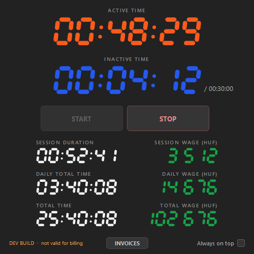

# Workhour Counter

Workhour Counter is a desktop application for tracking working time and creating verifiable work statements.

This application was built for professionals working on hourly-based projects where the amount billed should be traceable and need a clear, verifiable record of their computer-based working time.

Instead of receiving a number of hours and having to take it on trust, the client can receive a monthly statement containing individual work sessions, daily totals, hourly rates and calculated amounts. The records are digitally signed and can be independently checked using the application.



## Privacy Comes First

Workhour Counter **is not employee surveillance software**.

It uses minimal mouse movement detection to determine whether a working session is active.

**The application does not:**
- Log mouse position.
- Record mouse clicks.
- Record keyboard input.
- Take screenshots.
- Record screen content.
- Monitor websites or applications.
- Record or transmit user behavior.

The application does not try to understand what someone is doing on their computer. It only uses limited mouse movement information to help determine working time.

**The goal is to record working hours, not to watch people work.**

## Why Workhour Counter?

Hourly billing should be based on recorded working time, not on numbers that appear only when an invoice is created.

Workhour Counter creates a record throughout the project:

- **For Contractors:** Working time is recorded automatically, without maintaining manual timesheets.
- **For clients:** Monthly statements provide a traceable breakdown of recorded working time and costs.
- **For both sides:** Changes to existing records can be detected, and statements can be verified instead of relying only on the final amount.

> **Know your working hours. Protect your time. Keep your work transparent.**
This Software creates clear records of working hours. It can help prevent unpaid overtime and protect employees when managers do not understand how much work they do.

## Project launch settings

During the first launch, the application asks for three settings:

| Setting | Available values |
|---|---|
| Currency | EUR, USD, HUF |
| Hourly rate | User-defined |
| Maximum inactive time | 1–240 minutes |

**Once confirmed, these settings are locked.**

The application **does not provide a way to edit them later**. The settings file is digitally signed, and manually changing or deleting it prevents the existing worklog from being continued.

To use a different hourly rate for another project, create a separate application folder and complete the initial setup again.

For example:

```text
C:\Work\Project_A\WorkhourCounter.exe → 45.00 EUR / hour

C:\Work\Project_B\WorkhourCounter.exe → 60.00 USD / hour
```

Each folder maintains its own settings, worklogs and invoice history.

## How it works

<text> </text>

1. **Set up once.** Choose your currency, hourly rate and maximum inactive time.
2. **Start working.** Press Start. The application records your sessions automatically.
3. **Let it track.** Active and inactive time are handled automatically. No manual timesheets are needed.
4. **Generate a statement.** Create a PDF containing the recorded work and the corresponding amounts.
5. **Verify the records.** The monthly CSV files can be checked for changes using the application.

*Each project can have its own independent copy of the application, with its own hourly rate and records.*

## Automatic time tracking

Workhour Counter uses mouse movement to detect computer activity. It does not monitor keyboard input or record what appears on the screen.

**A movement of at least 5 pixels counts only as activity.** This filters out tiny movements caused by optical mouse sensors.

The application displays two main time counters:

| Counter | What it means |
|---|---|
| Active time (Orange) | Confirmed time accumulated between detected mouse movements |
| Inactive time (Blue) | Time elapsed since the last detected movement |

Session ,daily and overall total time, together with their calculated wages, are also displayed.

### Automatic idle handling

The default inactivity limit is 30 minutes and can be configured between 1 and 240 minutes during initial setup.

When the limit is exceeded:

- The current session ends at the last detected mouse movement.
- The inactive period is excluded from the recorded working time.
- The counters roll back to last detected mouse movement time (inactive time not billed)
- The session is saved automatically.
- Moving the mouse again starts a new session.

Example with a 30-minute limit:

```
09:00  Start
09:00–10:00  working          session #1 runs
10:00  you leave              blue timer starts counting, orange timer freezes
10:30  idle limit exceeded    session #1 saved: 09:00 → 10:00 (1:00:00)
13:00  you move the mouse     session #2 starts at 13:00
```

**No need to remember to stop the timer when leaving your computer. Inactive period is never billed.**

### Session recovery and time consistency

The application also handles situations that could otherwise lead to incomplete or inconsistent records:

- Closing the application asks for confirmation and saves the running session.
- Windows shutdown and log-off trigger automatic saving.
- A signed checkpoint is created every five minutes while a session is running, allowing recovery after a crash or power loss.
- Sleep and hibernation are treated as inactivity.
- System clock changes are detected using a monotonic clock as an independent time reference.
- Sessions cannot be started before the end of the last recorded session.

These rules help keep the work history consistent, whether interruptions happen accidentally or are caused deliberately.
## Records designed to expose changes

Every recorded session is saved in a monthly CSV file that can be opened in Excel.

For example:

`worklog_2026-11.csv`

Each row contains the recorded session, its duration, cumulative working time and calculated wages.

It also contains verification information:

| Field | Purpose |
|---|---|
| Hourly rate and currency | Identifies the calculation parameters |
| Lock ID | Identifies the original locked configuration |
| Build fingerprint | Identifies the application executable |
| UTC offset | Preserves the time zone information |
| Invoiced total | Tracks how much recorded time has already been invoiced |
| Digital signature | Detects modifications to the record |

### Chained digital signatures

Every CSV row is signed using HMAC-SHA256.

Each signature covers both the row's contents and the previous row's signature. This creates a chain of records.

> **As a result, changing a value, inserting a row or deleting a row from the middle breaks the signature chain.**

The application checks these records before continuing an existing worklog. It also provides a **Verify CSV** function that identifies the first invalid row.

This is not just a checksum of the entire file. Each individual record participates in the verification chain.

### Protection against common manipulation attempts

The application includes several additional checks:

| Potential manipulation | Detection mechanism |
|---|---|
| Editing recorded hours or wages | Row signature verification |
| Inserting or modifying records | Chained signatures |
| Removing records from the middle | Broken signature chain |
| Removing invoiced records | Invoice progress tracking |
| Deleting or renaming monthly files | File naming, month and continuity checks |
| Changing the hourly rate | Signed, locked settings |
| Replacing the settings file | Configuration identity check |
| Reusing an old crash checkpoint | Checkpoint consistency validation |
| Changing the system clock | Monotonic clock comparison |
| Recording work in the past | Session ordering validation |
| Modifying the invoice history | Signed, chained invoice records |

The application also checks that the recorded invoicing progress matches the worklog. Removing previously recorded invoices therefore cannot silently reset the billing history.

## Work statements and invoices

The **Invoices** window provides an overview of issued statements and their payment status.

A new PDF work statement includes:

- One entry per recorded working day.
- Working time and calculated amount for each day.
- Total working time and amount.
- The hourly rate and currency.
- The application build fingerprint and source worklog files.

**Previously invoiced working time cannot be billed again.**

Each issued statement remembers the cumulative worklog time it covers. The next statement starts where the previous one ended.

**This prevents the same recorded working time from being invoiced twice** or accidentally skipped.

Payments are tracked separately, and unpaid amounts are visible in the invoice overview.

## Verification by the client

A client does not have to rely only on the PDF or the developer's reported total.

The application provides a verification function that checks the underlying CSV records.

To verify a statement:

1. Keep the original application executable and its SHA-256 fingerprint.
2. Compare the executable fingerprint with the one shown by the developer.
3. Open the application's information dialog by clicking the build watermark.
4. Select **Verify CSV** and choose the monthly worklog.
5. Review the verification result, recorded sessions, total working time and calculated wages.

The same verification function also supports `invoices.csv`, including issued statements and payment records.

This makes it possible to review not only the final amount, but also the records behind it.

## Security model and limitations

> **Workhour Counter is designed to make accidental and deliberate changes to recorded data detectable.**

However, there is an important distinction between detecting manipulation and making manipulation impossible.

The signing key is generated separately for every release build and embedded into the compiled executable. It is removed from the source tree after the build.

The application uses Nuitka to compile Python into a native executable, but the embedded key is not impossible to extract. A sufficiently skilled reverse engineer could recover it. The same release build shares its key among all users.

Therefore:

- The signatures provide tamper detection within the application's security model.
- The build fingerprint helps identify which executable produced the records.
- Verification requires retaining the original release executable.
- The system is not designed to resist a determined attacker who controls the computer, reverse-engineers the executable or deliberately manipulates the application.

**The purpose is to provide a consistent, verifiable work history and make ordinary after-the-fact manipulation visible, not to claim absolute protection against every possible attack.**

### Release builds and development builds

Running the application from source uses a public development key.

Development-generated records are marked as `DEV` and are not accepted by release executables.

The application window also displays a development watermark:

`DEV BUILD · not valid for billing`

This keeps development records separate from release records intended for billing.

## Files and data storage

The application keeps all work-related data in a dedicated `workhour_data` folder next to the executable.

The folder structure looks like this:

```text
WorkhourCounter.exe
.workhour_running               # Exists only while the application is running
workhour_data/
├── workhour_settings.lock      # Signed, locked configuration
├── worklog_YYYY-MM.csv         # Monthly working-time records
├── invoices.csv                # Invoice and payment history
├── workhour_checkpoint.json    # Temporary crash recovery checkpoint
└── generated_invoices/
    └── invoice_2026-11-18.pdf  # Generated PDF work statements
```

The `.workhour_running` file prevents multiple instances from running in the same application folder. It is automatically present only while the application is running.

**Important:** Do not keep additional copies of worklog CSV files inside `workhour_data`, and do not save the original CSV files from Excel.

Open CSV files read-only or work with a separate copy outside the `workhour_data` folder. The application validates its data files on startup and may refuse to start if unexpected files or modifications are detected.

---

## Running from source

Requirements: Python 3.8 or newer on Windows.

```bash
pip install -r requirements.txt
python main.py
```

Running from source, the application creates the `workhour_data` folder next to `main.py` and uses the development signing key.

The icon is generated by `python tools/make_icon.py` (and can be found here:
`assets/icon.ico`).

## Tests

Run the test suite using:

```bash
python -m unittest -v
```

The tests cover:

- Activity detection and idle handling.
- Session closing, rollback and recovery.
- Sleep, hibernation and system clock changes.
- Monthly and midnight record splitting.
- CSV structure and signature verification.
- Settings integrity.
- Missing, modified, copied and renamed worklogs.
- Checkpoint validation.
- Invoice creation, payment tracking and duplicate billing prevention.
- PDF work statement generation.
